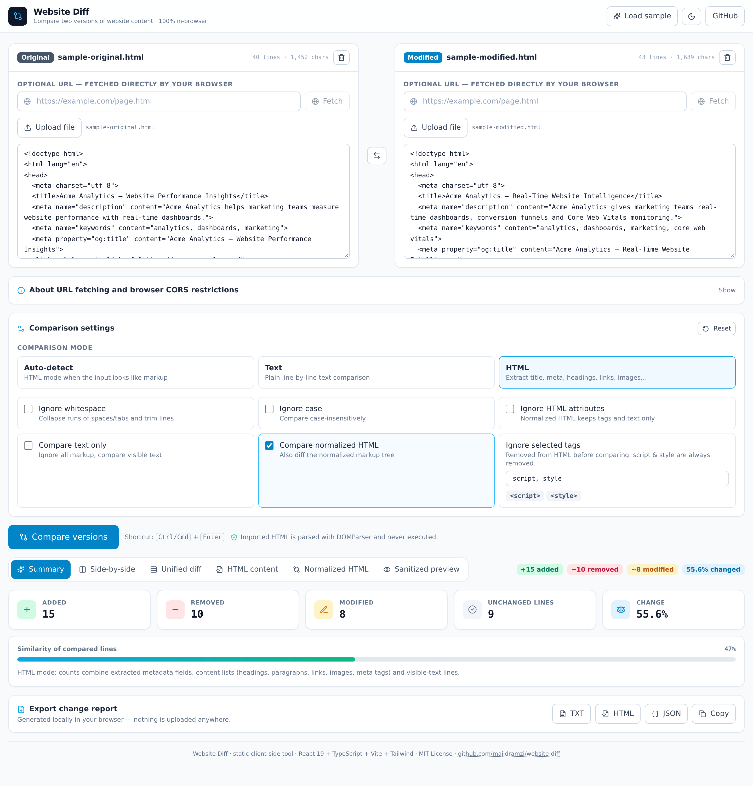
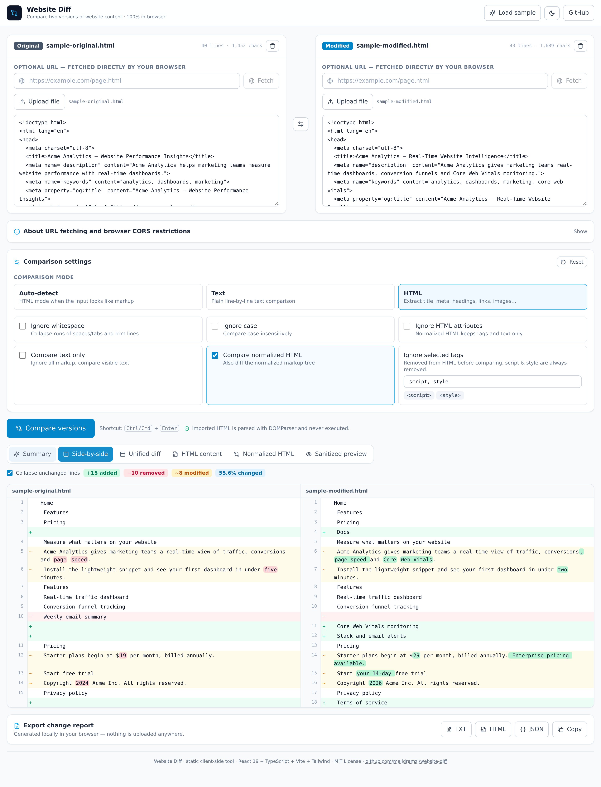
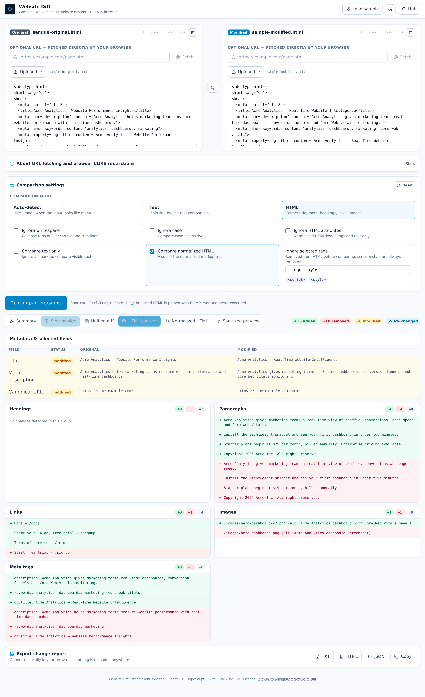
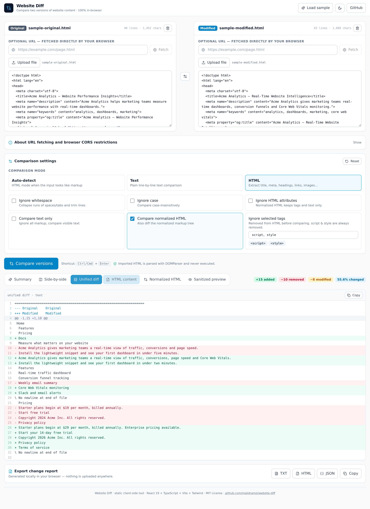
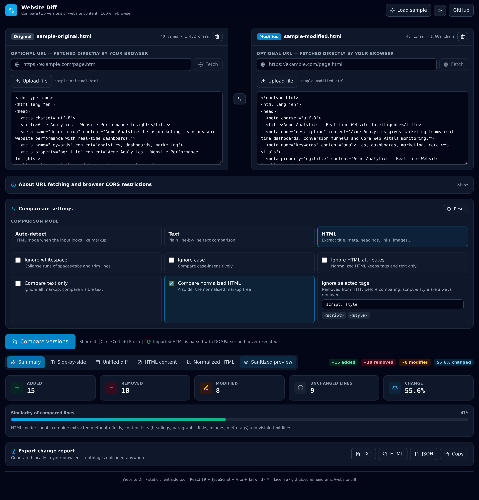
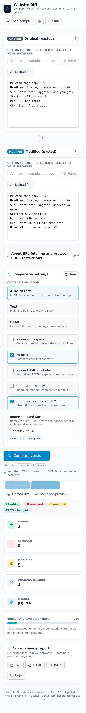

# Website Diff

**Compare two versions of website content — text or HTML — entirely in your browser.**

Website Diff is a static, dependency-light developer utility that shows you exactly what
changed between two versions of a page: the title, meta description, canonical URL, headings,
paragraphs, links, images and metadata, plus a line- and word-level diff of the visible text.
There is **no backend, no proxy and no upload**: everything happens client-side.

Built with **React 19 · TypeScript · Vite · Tailwind CSS · lucide-react · diff · DOMParser · DOMPurify · Vitest**.

---

## Live Demo

> **Live demo placeholder** — once the GitHub Pages deployment is live, the app is served at:
>
> **<https://majidramzi.github.io/website-diff/>**
>
> (Deployed automatically by the GitHub Actions workflow in [`.github/workflows/deploy.yml`](.github/workflows/deploy.yml).)

Run it locally in one command:

```bash
npm install
npm run dev
```

---

## Screenshots

| Summary & statistics | Side-by-side diff with word-level highlights |
|---|---|
|  |  |

| Extracted HTML content changes | Unified diff |
|---|---|
|  |  |

| Dark theme | Responsive mobile layout |
|---|---|
|  |  |

More captures: empty state (`01`), normalized-HTML diff (`06`), sanitized preview (`07`),
plain-text comparison (`09`). Regenerate all of them with `npm run screenshots` (see
[Development](#development)).

---

## Features

- **Text comparison** — added lines, removed lines and in-place modified sections.
- **HTML comparison** — page title, meta description, canonical URL, headings (with levels),
  paragraphs, links (text + `href`), images (`src` + `alt`) and selected `<meta>` tags.
- **Side-by-side view** with line numbers and word-level inline highlighting.
- **Unified diff view** (`---` / `+++` / `@@` hunks) with copy-to-clipboard.
- **Normalized HTML diff** — compare the sanitized markup tree after applying your options.
- **Sanitized preview** — render imported HTML safely through DOMPurify.
- **Summary panel** — added / removed / modified counts, unchanged lines and change percentage.
- **Comparison options** — ignore whitespace, ignore case, ignore HTML attributes, ignore
  selected tags, compare text only, compare normalized HTML.
- **Exports** — TXT report, standalone HTML report (script-free, escaped) and JSON report.
- **Themes** — light and dark, persisted in `localStorage`, honoring `prefers-color-scheme`.
- **Responsive** — panels stack on small screens; the diff tables scroll horizontally.
- **Keyboard** — `Ctrl/Cmd + Enter` runs the comparison.

---

## Supported input types

| Method | How it works |
|---|---|
| **Paste text** | Two textareas accept any plain text (one version per panel). |
| **Paste HTML** | Full HTML documents or fragments; parsed with `DOMParser`, never executed. |
| **File upload** | Two local `.html` / `.htm` / `.txt` files, read with the File API — nothing is uploaded. |
| **URL fetch** | Optional URL per panel, fetched with the browser **Fetch API only** (see CORS below). |

The comparison mode can be **Auto-detect** (HTML mode when either input looks like markup),
**Text**, or **HTML**. In HTML mode, if the input turns out to contain no structure at all,
the tool gracefully falls back to a plain-text comparison.

---

## Comparison modes & options

- **Auto-detect / Text / HTML** — choose the engine explicitly or let the tool decide.
- **Ignore whitespace** — collapses runs of spaces/tabs and trims each line before matching.
- **Ignore case** — case-insensitive matching.
- **Ignore HTML attributes** — the normalized-HTML diff keeps tags and text only.
- **Ignore selected tags** — e.g. `nav, footer`; those elements are removed before comparing.
  `script` and `style` are always removed.
- **Compare text only** — ignores markup entirely and compares visible text.
- **Compare normalized HTML** — additionally produces a diff of the normalized markup tree.

Changed lines are paired by word similarity, so a genuinely new line is reported as *added*
and a deleted line as *removed*, while an edited line is reported as *modified*.

---

## CORS limitations (important)

This is a **static site with no backend**, so URL fetching uses the browser Fetch API directly.
Browsers enforce the same-origin policy: the remote server must send an
`Access-Control-Allow-Origin` header that permits this origin, otherwise the response body
cannot be read.

**Most public websites block cross-origin reads.** When that happens Website Diff shows a clear
error in the affected panel — never a silent failure. By design there is **no proxy server and
no paid backend** that would circumvent CORS.

Workarounds when a site blocks you:

1. Open the page, save it (`Ctrl/Cmd + S`) and **upload the saved file**.
2. View page source and **paste the HTML** into a panel.
3. Run `curl -s https://example.com/page > page.html` locally and upload `page.html`.
4. Host a static copy on a server that sends permissive CORS headers.

---

## Security notes

- **Imported HTML is never executed.** Parsing uses `DOMParser`, which produces an inert
  document; `script` and `style` are stripped before any extraction.
- **All imported content is treated as untrusted.** The single place where markup is inserted
  into the DOM (the Sanitized preview) is passed through **DOMPurify** with scripts, iframes,
  objects, forms, `srcdoc` and event handlers forbidden.
- **No unsafe `innerHTML` with raw input.** Diff views, lists and reports render text nodes;
  exported HTML reports escape every character of user content.
- **Normalized markup is hardened**: `on*` handlers and `javascript:` URLs are removed from
  untrusted input before it is serialized into reports.
- **Nothing leaves your machine.** Files are read locally, comparisons run in the tab, and
  exports are generated as local downloads. No analytics, no telemetry, no storage server.

---

## Installation

Requires **Node.js 20+** and npm.

```bash
git clone https://github.com/majidramzi/website-diff.git
cd website-diff
npm install
```

---

## Development

```bash
npm run dev         # start the Vite dev server (base "/" for local work)
npm run typecheck   # strict TypeScript check, no emit
npm run build       # typecheck + production build into dist/ (base "/website-diff/")
npm run preview     # serve the production build locally at /website-diff/
```

Useful environment override: `VITE_BASE=/my-base/ npm run build` if you deploy elsewhere.

### Regenerating screenshots

```bash
npm run build
npm i -D playwright
npx playwright install chromium
npm run screenshots   # writes docs/screenshots/*.png via a headless browser
```

The script (`scripts/screenshots.mjs`) starts `vite preview`, drives the UI like a user would
(load sample → compare → each tab → theme toggle → mobile viewport) and captures PNGs.

### End-to-end verification

```bash
npm run build
npm run verify:e2e
```

`scripts/e2e-verify.mjs` runs the production build in headless Chromium and asserts the full
user journey: uploading two HTML files, HTML metadata extraction (title, meta description,
links), plain-text comparison with modified/added lines, and real downloads of the TXT, HTML
and JSON reports.

---

## Testing

Tests run with **Vitest** in a `jsdom` environment — no browser required.

```bash
npm test          # single run
npm run test:watch
```

Coverage includes:

- added / removed / modified text lines and unified-diff output;
- HTML title, meta description and canonical URL comparison;
- link, heading, paragraph, image and meta-tag changes;
- whitespace and case normalization;
- malformed HTML (unclosed tags, unquoted attributes, missing `</head>`, hostile payloads);
- comparison options (ignore attributes/tags, text-only, normalized HTML);
- exported TXT / HTML / JSON reports (escaping, counts, absence of scripts);
- security behavior (DOMPurify sanitization, no script execution, no `onerror` leakage);
- UI smoke tests (rendering, comparing, tabs, theme toggle, swap, options, collapse).

---

## Build

```bash
npm run build
```

Produces a fully static bundle in `dist/` with asset URLs prefixed by `/website-diff/`,
plus `dist/.nojekyll` so GitHub Pages does not run Jekyll over it.

---

## Deployment (GitHub Pages)

The repository ships with [`.github/workflows/deploy.yml`](.github/workflows/deploy.yml):
on every push to `main` it **runs the type check, the unit tests and the production build**,
then uploads `dist/` as a Pages artifact and deploys it with `actions/deploy-pages`.
Pull requests run the same checks without deploying.

Expected production URL: **<https://majidramzi.github.io/website-diff/>**

One-time repository setup:

1. **Settings → Pages → Source:** choose **GitHub Actions**.
2. Ensure the default branch is `main`.
3. Push to `main`; the workflow builds and deploys automatically.

No backend, no paid service, no secrets are required — the workflow only uses the built-in
`GITHUB_TOKEN` with `pages: write` / `id-token: write` permissions.

Manual deploy (e.g. to any static host) also works: upload the contents of `dist/` to the
`/website-diff/` path of your host, or set `VITE_BASE` to match your deployment path.

---

## Privacy

- Pasted text, uploaded files and fetched URLs are processed **only inside your browser tab**.
- No content is uploaded, logged, cached server-side or sent to any third party.
- The theme preference is stored in `localStorage` on your device and nowhere else.
- The repository contains no analytics scripts and no tracking pixels.

---

## Project structure

```
website-diff/
├── .github/
│   └── workflows/
│       └── deploy.yml            # test → build → deploy dist/ to GitHub Pages
├── docs/
│   └── screenshots/              # README screenshots (regenerate with npm run screenshots)
├── public/
│   ├── .nojekyll                 # disable Jekyll processing on GitHub Pages
│   └── favicon.svg
├── scripts/
│   ├── e2e-verify.mjs            # headless-browser E2E check (upload, compare, exports)
│   └── screenshots.mjs           # headless-browser screenshot generator
├── src/
│   ├── __tests__/
│   │   ├── app.test.tsx          # UI smoke tests (render, compare, tabs, theme, options)
│   │   ├── compare.test.ts       # mode resolution, options, samples
│   │   ├── diff.test.ts          # line diff, modified pairing, normalization
│   │   ├── export.test.ts        # TXT/HTML/JSON report content and escaping
│   │   ├── fetchUrl.test.ts      # CORS errors, HTTP errors, file reading
│   │   ├── html.test.ts          # extraction, metadata, lists, malformed HTML
│   │   └── security.test.ts      # DOMPurify behavior, untrusted content
│   ├── components/
│   │   ├── ExportBar.tsx         # TXT / HTML / JSON / copy exports
│   │   ├── HtmlContentView.tsx   # metadata + content-list change tables
│   │   ├── InlineDiff.tsx        # word-level highlight segments
│   │   ├── InputPanel.tsx        # textarea + URL fetch + file upload per side
│   │   ├── OptionsPanel.tsx      # mode + comparison options
│   │   ├── SideBySideView.tsx    # aligned two-column diff with collapsing
│   │   ├── SourcePreview.tsx     # DOMPurify-sanitized render + escaped raw source
│   │   ├── SummaryPanel.tsx      # counts, change %, similarity bar
│   │   └── UnifiedView.tsx       # unified patch view
│   ├── lib/
│   │   ├── compare.ts            # mode resolution + top-level comparison
│   │   ├── diff.ts               # line diff + similarity-based modified pairing
│   │   ├── export.ts             # TXT/HTML/JSON report builders + download
│   │   ├── fetchUrl.ts           # direct Fetch API + File API readers
│   │   ├── html.ts               # DOMParser extraction + normalization + lists
│   │   ├── normalize.ts          # whitespace/case normalization + helpers
│   │   ├── samples.ts            # bundled demo documents
│   │   ├── sanitize.ts           # DOMPurify wrapper
│   │   └── types.ts              # shared TypeScript types & defaults
│   ├── App.tsx                   # layout, state, tabs, theme
│   ├── index.css                 # Tailwind layers + diff theming
│   └── main.tsx                  # React root
├── index.html
├── package.json
├── tailwind.config.js
├── tsconfig.json
└── vite.config.ts                # base "/website-diff/" for build/preview, Vitest config
```

---

## Contributing

Contributions are welcome — bug reports, feature ideas, docs and pull requests.

1. Fork the repository and create a topic branch from `main`.
2. Install dependencies (`npm install`) and keep the checks green:
   `npm run typecheck`, `npm test`, `npm run build`.
3. Add or update tests for any behavior change (Vitest, colocated in `src/__tests__/`).
4. Keep the security model intact: no server round-trips for user content, no execution of
   imported HTML, sanitize everything rendered.
5. Open a pull request with a clear description and, for UI changes, screenshots.

Please keep commits focused and use conventional-style messages
(`feat:`, `fix:`, `docs:`, `test:`, `chore:`).

---

## License

MIT — see [LICENSE](LICENSE). © 2026 Majid Ramzi.
